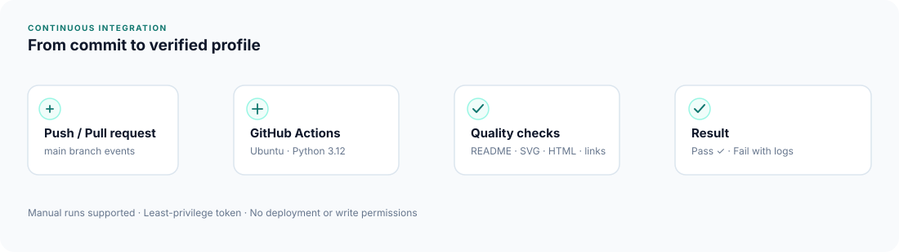
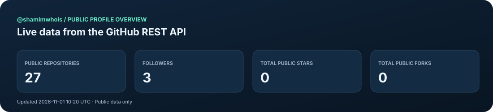
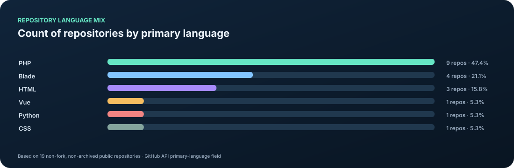
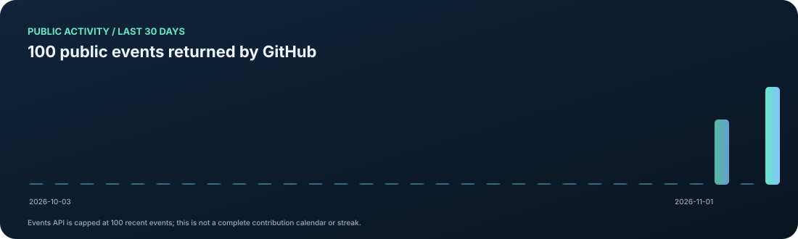

  <a href="https://shamimhossain.dev">WEBSITE</a> ·
  <a href="https://github.com/shamimwhois">GITHUB</a> ·
  <a href="https://www.linkedin.com/in/shamimwstack">LINKEDIN</a> ·
  <a href="mailto:shamimstack@gmail.com">EMAIL</a>

## 01 / About

I'm a software engineer focused on backend development, Laravel applications, developer tools, and practical AI integrations.

> **Profile views:** GitHub does not expose personal profile-view counts through its public REST API. The former third-party image counter was removed because image requests are not a reliable measure of unique profile visitors.

I turn complex requirements into maintainable software, with an emphasis on clear architecture, security, testing, and reliable delivery.

- **Building:** PHP and Laravel applications, packages, APIs, and SaaS platforms.
- **Exploring:** AI integrations, local LLMs, agentic workflows, and MCP tooling.
- **Improving:** Storage systems, automation, CI/CD, and developer experience.

## 02 / Featured work

### [Storix — One API. Every Storage.](https://github.com/shamimwhois/storix)

A provider-neutral storage and transfer package for Laravel, designed around replaceable drivers, integrity checks, and resilient file workflows.

[Source code](https://github.com/shamimwhois/storix) · [Documentation](https://shamimwhois.github.io/storix/)

| Project | Description |
| --- | --- |
| [Storix](https://github.com/shamimwhois/storix) | Provider-neutral file storage and transfer for Laravel. |
| [Portfolio](https://github.com/shamimwhois/portfolio) | Personal portfolio built with Laravel and Livewire. |
| [/dev/null](https://github.com/shamimwhois/dev-null.sh) | Open-source social network for developers. |
| [All repositories](https://github.com/shamimwhois?tab=repositories) | More projects, experiments, and tools. |

## 03 / GitHub ecosystem & specialized profiles

The profile's historical GitHub network contained multiple purpose-specific identities. These account names have been restored from the original profile README rather than inferred from repository names.

| GitHub account | Focus area |
| --- | --- |
| [@shamimwhois](https://github.com/shamimwhois) | Main personal profile |
| [@laravelgpt](https://github.com/laravelgpt) | AI-powered Laravel and MCP |
| [@shamimlaravel](https://github.com/shamimlaravel) | Laravel packages and tools |
| [@shamimstack](https://github.com/shamimstack) | Laravel infrastructure |
| [@gsmui](https://github.com/gsmui) | GSM tools, UI libraries, and MCP |
| [@gsmcodex](https://github.com/gsmcodex) | GSM development and tooling |
| [@ufstool](https://github.com/ufstool) | Security and OSINT research |
| [@pkgmcp](https://github.com/pkgmcp) | MCP protocol and package tooling |
| [@gsmsdk](https://github.com/gsmsdk) | GSM/SMS SDKs |
| [@GSMWhale](https://github.com/GsmWhale) | GSM firmware and embedded systems |
| [@shamimloop](https://github.com/shamimloop) | Experimental projects and labs |
| [@shamimvue](https://github.com/shamimvue) | Vue ecosystem experiments |
| [@ZenithFramework](https://github.com/ZenithFramework) | Zenith PHP framework |
| [LaravelGpt](https://github.com/LaravelGpt) | LaravelGpt GitHub account |

Professional profile: [LinkedIn](https://www.linkedin.com/in/shamimwhois).

## 04 / Domains & web properties

### Personal and portfolio domains

| Domain | Historical profile role |
| --- | --- |
| [shamimhossain.dev](https://shamimhossain.dev) | Personal website |
| [shamim.dev](https://shamim.dev) | Short personal domain |
| [shamim.uk](https://shamim.uk) | Personal domain |
| [shamim.it](https://shamim.it) | Personal domain |
| [shamim.help](https://shamim.help) | Personal/help domain |
| [shamimstack.com](https://shamimstack.com) | Developer brand |
| [shamimhossain.com.bd](https://shamimhossain.com.bd) | Bangladesh personal domain |
| [shamimhossain.com](https://shamimhossain.com) | Historical personal domain reference |
| [shamimcoder.com](https://shamimcoder.com) | Historical personal domain reference |
| [shamimdev.dev](https://shamimdev.dev) | Historical personal domain reference |

### Framework, product, and project properties

| Domain | Project |
| --- | --- |
| [zenithframework.com](https://zenithframework.com) | Zenith Framework |
| [lang.zenithframework.com](https://lang.zenithframework.com) | Zenith language documentation |
| [dev-null.sh](https://dev-null.sh) | Developer community |
| [gsmwhale.com](https://gsmwhale.com) | GSMWhale product platform |
| [pkgmcp.com](https://pkgmcp.com) | Package distribution concept |
| [Storix documentation](https://shamimwhois.github.io/storix/) | Storix docs |

*The additional historical domains are restored from older profile revisions. Their current ownership, DNS, and availability have not been independently verified; links are retained as an archive of the previous profile directory.* 

## 05 / Technology toolkit

**Backend:** PHP · Laravel · REST APIs · MySQL · PostgreSQL · Redis  
**Frontend:** Livewire · JavaScript · TypeScript · Tailwind CSS · Alpine.js  
**Engineering:** Git · GitHub Actions · Docker · Linux · CI/CD  
**AI:** LLM integrations · Ollama · MCP · Agentic workflows

## 06 / Engineering workflow

This repository uses GitHub Actions to check required README sections, account and domain URL presence, workflow diagram presence, landing-page HTML structure, and internal navigation.

[View workflow runs](https://github.com/shamimwhois/shamimwhois/actions) · [Workflow source](.github/workflows/profile-ci.yml)

## 07 / GitHub Stats & Visuals

These visuals are generated by this repository's own GitHub Actions workflow using the official GitHub REST API. No third-party stats-rendering service is used.

### Public profile overview

### Repository language distribution

### Recent public activity

**Data definitions**
- Profile counters, repository totals, stars, and forks come from the official GitHub REST API.
- Language distribution counts each repository's GitHub-reported primary language; it is not a byte-level code breakdown.
- Activity counts are public events returned by GitHub's Events API. The API is capped, so this is not a complete contribution calendar, contribution streak, or private-activity report.
- The workflow refreshes the generated SVGs daily and on demand. See [the generator](scripts/generate_github_stats.py), [workflow runs](https://github.com/shamimwhois/shamimwhois/actions/workflows/profile-ci.yml), and [raw stats data](./assets/github-stats/stats.json).

[View live GitHub activity](https://github.com/shamimwhois?tab=activity) · [Browse repositories](https://github.com/shamimwhois?tab=repositories)

---

*Building useful things. Improving them every day.*

